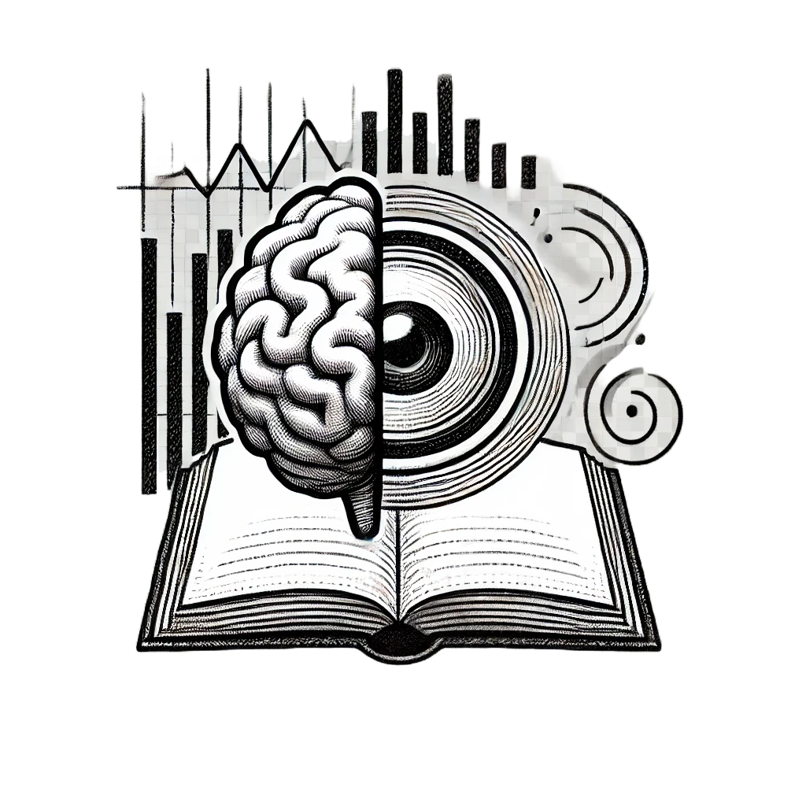

# AnyModal: A Flexible Multimodal Language Model Framework



**AnyModal** is a modular framework for building multimodal language models in PyTorch. It bridges
pretrained vision (or other modality) encoders with large language models via pluggable **projector
architectures** — letting you train a multimodal model with just a config file and a few lines of code.

## Key Features

- **5 Projector Architectures**: Linear, MLP, Q-Former (BLIP-2), Perceiver Resampler (Flamingo), C-Abstractor (Honeybee)
- **Pluggable Encoders**: ViT, SigLip, CLIP, DINOv2 — any HuggingFace vision model works out of the box
- **Config-Driven**: YAML configs for all hyperparameters; CLI overrides for experiments
- **HuggingFace Trainer Integration**: LR scheduling, gradient clipping, mixed precision, checkpointing, wandb/tensorboard
- **Proper Packaging**: `pip install` support, type-annotated API, tested with CI
- **PEFT/LoRA Support**: Optional LoRA on both the vision encoder and language model

## Installation

```bash
pip install -e .

# With optional dependencies:
pip install -e ".[peft]"          # LoRA support
pip install -e ".[quantization]"  # 4-bit / 8-bit quantization
pip install -e ".[all]"           # Everything
```

## Quick Start

### Option 1: Config-Driven (Recommended)

```bash
# Train an image captioning model
cd examples/image_captioning
python ../train.py --config config.yaml

# Run inference
python ../inference.py --config config.yaml --model_dir ./output/image_captioning/final
```

### Option 2: Python API

```python
from anymodal import ModelConfig, EncoderConfig, ProjectorConfig, build_model

config = ModelConfig(
    encoder=EncoderConfig(model_name="google/vit-base-patch16-224"),
    projector=ProjectorConfig(type="qformer", kwargs={"num_queries": 32}),
    prompt_text="Describe this image: ",
)

processor, model = build_model(config)
model.print_trainable_parameters()

# Training
logits, loss = model({"input": batch_pixel_values, "text": captions})
loss.backward()

# Inference
generated = model.generate(sample_input, max_new_tokens=100)
```

### Option 3: HuggingFace Trainer

```python
from anymodal import build_model, build_hf_trainer, TrainingConfig, MultiModalDataset

processor, model = build_model(config)

train_dataset = MultiModalDataset(
    dataset_name="AnyModal/flickr30k",
    processor=processor,
    image_field="image",
    text_field="original_alt_text",
    split="train",
)

trainer = build_hf_trainer(
    model, TrainingConfig(num_epochs=3, fp16=True), train_dataset
)
trainer.train()
model.save_pretrained("./output/final")
```

## Projector Architectures

The projector is the key trainable component — it maps encoded modality features into the LLM's
embedding space. Choose based on your needs:

| Projector | Based On | Resamples? | Best For |
|-----------|----------|------------|----------|
| `linear` | LLaVA v1 | No | Quick experiments, minimal overhead |
| `mlp` | LLaVA v1.5 | No | General-purpose, good default |
| `qformer` | BLIP-2 | Yes → N queries | Fixed output length, cross-attention |
| `perceiver` | Flamingo | Yes → N latents | Rich latent interactions, longer inputs |
| `c_abstractor` | Honeybee | Yes → spatial pool | Vision tasks with spatial structure |

```python
# Switch projector with one line:
ProjectorConfig(type="perceiver", kwargs={"num_latents": 64, "num_layers": 4})
```

## Architecture

```
[Input] → Processor → Encoder → Projector → [start_token | projected_tokens | end_token | prompt] → LLM → Text
                                    ↑                                                                  ↑
                            (trainable)                                                    (frozen or LoRA)
```

## Examples

| Task | Config | Vision Model | LLM |
|------|--------|-------------|-----|
| [Image Captioning](examples/image_captioning/) | [config.yaml](examples/image_captioning/config.yaml) | ViT-base-224 | Llama 3.2-1B |
| [LaTeX OCR](examples/latex_ocr/) | [config.yaml](examples/latex_ocr/config.yaml) | SigLip-384 | Llama 3.2-1B + LoRA |
| [LexiCaption](examples/lexicaption/) | [config.yaml](examples/lexicaption/config.yaml) | SigLip-384 | Llama 3.2-1B + LoRA |
| [Radiology Caption](examples/radiology_caption/) | [config.yaml](examples/radiology_caption/config.yaml) | ViT-base-224 + LoRA | Llama 3.2-1B |

Train any example:
```bash
cd examples/image_captioning
python ../train.py --config config.yaml --projector_type qformer --num_epochs 5
```

## Model Zoo

Pre-trained models available on [HuggingFace](https://huggingface.co/AnyModal):

- **[Image-Captioning-Llama-3.2-1B](https://huggingface.co/AnyModal/Image-Captioning-Llama-3.2-1B)**: ViT + Llama 3.2-1B on Flickr30k

## Extending AnyModal

### Custom Encoder

```python
from anymodal.encoders import BaseEncoder

class AudioEncoder(BaseEncoder):
    @property
    def hidden_size(self) -> int:
        return 768

    def forward(self, inputs):
        # Your encoding logic
        return features  # (batch, seq_len, 768)
```

### Custom Projector

```python
from anymodal.projectors import BaseProjector

class MyProjector(BaseProjector):
    def forward(self, x: torch.Tensor) -> torch.Tensor:
        # (batch, seq, input_dim) → (batch, seq, output_dim)
        return self.transform(x)
```

## Development

```bash
pip install -e ".[dev]"
pytest tests/ -v
ruff check src/ tests/
```

## Community

- [r/AnyModal](https://www.reddit.com/r/AnyModal)
- [HuggingFace](https://huggingface.co/AnyModal)

## License

MIT License. See [LICENSE](LICENSE) for details.
